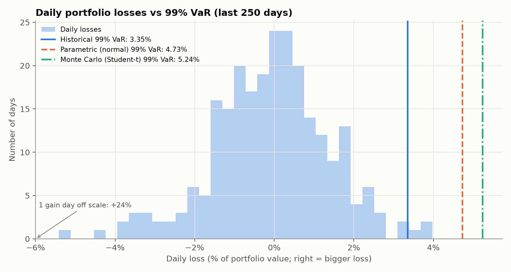
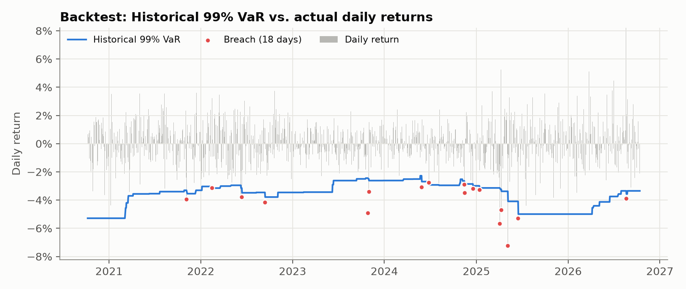

# Pharma Portfolio Risk: VaR, Backtesting and Stress Testing

How much could a portfolio of pharma and biotech stocks lose in a day? Do
standard risk models get that right? And what happens in a crisis?

This project measures the market risk of a $1m, equally weighted portfolio of
ten pharma and biotech stocks, using three Value-at-Risk methods, a regulatory-style backtest and three stress tests.



## What it does

| Step | Detail |
|---|---|
| **Data** | 10 US-listed stocks, daily prices from Yahoo Finance since 2019 |
| **VaR** | 1-day VaR at 95% and 99%, three ways: historical simulation, parametric (normal) and Monte Carlo (fat-tailed Student-t). Plus Expected Shortfall at 97.5%. |
| **Backtest** | Rolling daily forecasts with no look-ahead, tested with the Kupiec (breach count) and Christoffersen (clustering) tests and the Basel traffic light |
| **Stress tests** | a −12% sector-wide shock, a single-biotech trial failure (−30%) at 5–50% concentration, and a replay of the March 2020 COVID crash. |
| **Report** | A summary memo for a non-technical senior reader: [summary_memo.md](summary_memo.md) |

## Key findings

- **Exposure:** 99% one-day VaR is about **$33,500** (historical method).
- **Backtest:** Over 1,510 days, the parametric (normal) model failed at 99%, with 24 breaches against 15 expected. Historical and Monte Carlo passed, though all three breached slightly more often than expected.
- **Biggest risk:** A 12% fall across the sector would cost $120,000 (3.6× VaR). Holding more pharma stocks doesn't help, because they all fall together.
- **Concentration:** A 30% trial failure costs less than a day's VaR at a 10% holding, but more above about 11%, and VaR barely rises as the holding grows.

Full write-up: [summary_memo.md](summary_memo.md).



## How to run

```bash
python -m venv .venv
source .venv/bin/activate
pip install -r requirements.txt

python run_analysis.py      # writes tables and charts to output/
python -m pytest -q         # runs the tests
```

The first run downloads prices and saves them to `data/prices.csv`. Add
`--refresh` to download fresh prices. All assumptions (stocks, confidence
levels, scenario sizes) are in `pharmarisk/config.py`.

## Project layout

```
pharmarisk/
  config.py     all assumptions in one place: stocks, levels, scenario sizes
  data.py       downloads and caches prices, computes daily returns
  var.py        historical, parametric and Monte Carlo VaR, plus Expected Shortfall
  backtest.py   rolling VaR forecasts, Kupiec and Christoffersen tests, traffic light
  stress.py     sector shock, trial failure and COVID replay
  analysis.py   runs everything and collects the results as tables
  plots.py      the three charts
  run_analysis.py  one command: data -> results -> tables and charts in output/
  tests/           automated checks on cases where the right answer is known
  output/          generated tables (CSV) and charts (PNG)
  summary_memo.md  findings and recommendations for a non-technical reader

```

## Limitations

VaR covers one day only and says how often a large loss happens, not how large it can get. It only learns from the last 250 days, so events outside that window, such as a pandemic or a first-ever trial failure, are invisible to it; that is why the stress tests are included. The stock list was chosen with hindsight (survivorship bias), and currency risk for the five European companies is mixed into their US-dollar prices. See the memo for the full list.

## How this was built

I built this project to learn quantitative risk from scratch, using Claude (Anthropic's AI assistant) as a tutor. I wrote the code module by module, from data download through VaR, backtesting, stress tests, charts and tests. I prepared a template using Virtual Studio Code , and with the assistance of Claude, the memo was curated, with verification of every figure against the project's outputs. 