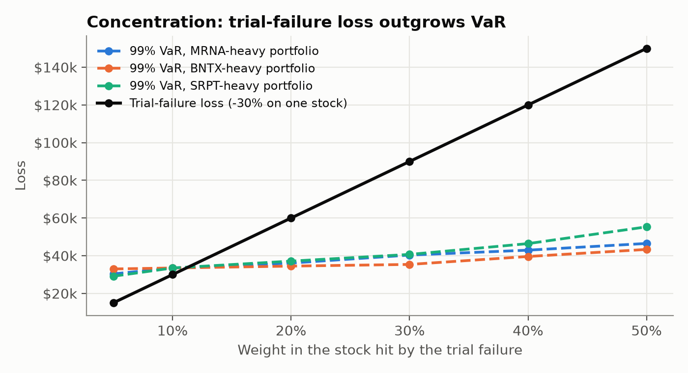

# Pharma portfolio risk: summary

**To:** Head of Risk   **From:** Sultan Akingbogun   **Date:** 16 October 2026

## Bottom line

On most days the portfolio's losses stay below **$33,500**, the 99% one-day
VaR. We expect that line to be crossed on about 1 day in 100, roughly
2-3 times a year. The historical model behind this number passed its
backtest: over the past six years it was crossed 18 times, close to
the 15 times we would expect.

The biggest risk is not a normal bad day but an event that hits every pharma
stock at once, such as a US drug-pricing or tariff announcement. Our backtest shows clusters of large losses around two recent examples: RFK Jr. being named health secretary (November 2024) and US tariff threats on pharma imports (April 2025). A 12% fall across the
sector would cost **$120,000**, about 3.6× VaR. Holding ten pharma stocks does not protect us from this.

## How much could we lose in a day?

| Method | 95% VaR | 99% VaR |
|---|---|---|
| **Historical (recommended)** | $22,287 | $33,491 |
| Parametric (normal) | $32,955 | $47,292 |
| Monte Carlo (Student-t) | $31,668 | $52,357 |

- **What VaR means:** on 99 trading days out of 100, we expect to lose
  less than about $33,500. On the remaining day, the loss will be larger,
  and VaR does not tell us by how much.
- **Expected Shortfall (97.5%): $32,885.** This is the average loss on the
  worst 2.5% of days, so it tells us how bad a bad day typically is.
  It is measured at 97.5%, the level regulators use, so it averages a slightly wider set of bad days and comes out close to 99% VaR rather than above it.
- **Why we recommend Historical:** it is based on what has actually happened over the past year (real daily returns),
  not on an assumed bell curve. The other two give figures about 40-56%
  higher, because one exceptional gain day (Moderna's vaccine trial results in August 2026, leading to them seeing a 177% rise, and a 24% rise for the portfolio), inflating their measure of volatility, so they count a windfall as risk.
- All figures use the last 250 trading days and a $1m portfolio with
  $100,000 in each stock.

## Can we trust the models?

We tested each model by going back day by day over the past six years:
each day we calculated VaR using only the previous year's data, then checked
whether the actual loss was bigger. A good 99% model should be crossed on
about 1 day in 100.

- **Historical and Monte Carlo passed** at both 95% and 99%. Historical was
  crossed 18 times against 15 expected.
- **Parametric failed at 99%:** crossed 24 times against about 15
  expected, too many to be bad luck. It assumes returns follow a bell curve,
  but real markets have fat tails, so its 99% line is set
  too low, therefore real bad days go past it more often than it predicts. At 95% it passed, because the 95% line covers moderately bad days, where a bell curve is a reasonable fit. The difference only shows in the extreme tail.
- **All three models lean the same way:** every one was crossed more often
  than expected, at both levels. Even the models that passed tend to
  understate risk slightly.

## What could go badly wrong?

VaR only knows the last year, so we also tested three specific scenarios.

| Scenario | Loss | × 99% VaR |
|---|---|---|
| Sector shock: every stock falls 12% | $120,000 | 3.6× |
| COVID replay: worst single day (12 March 2020) | $81,412 | 2.4× |
| COVID replay: peak to trough (19 Feb – 23 Mar 2020) | $73,168 | 2.2× |
| Trial failure: one biotech falls 30%, at a 10% holding | $30,000 | 0.9× |
| Trial failure: same, at a 30% holding | $90,000 | 2.7× |

- **The sector shock is the largest risk.** All ten stocks fall together, so there are no gains elsewhere to offset the losses. Holding more pharma names would not help; only holdings outside the sector would.
- **COVID cost less than expected** because two of our stocks, Moderna and
  BioNTech, rose sharply while the other eight fell about 22%. That
  cushion was luck: they were developing COVID vaccines, so this particular crisis was good news for them. The next crisis, such as a drug-pricing law or a financial crash, is unlikely to come with a built-in hedge.
- **Concentration matters for biotechs.** At today's 10% holding, a trial
  failure costs less than one day's VaR. But the loss grows in a straight line
  with the holding, while VaR barely moves: at 50% the loss is $150,000 but VaR
  is only about $43,000-$55,000. Above about 11% in one stock, a single failed
  trial would cost more than a 1-in-100 bad day.
  

## Recommendations

1. **Report historical VaR as the headline figure,** with Monte Carlo as a
   cross-check. Do not rely on the parametric model: over the backtest it
   set its line too low and was crossed too often (24 times against 15 expected), and today it overstates risk, because a single gain day inflated its volatility.

2. **Cap any single biotech at about 11% of the portfolio.** Above that,
   one failed trial (a 30% fall) would cost more than a day's 99% VaR,
   and VaR itself would not warn us, because it barely rises as the holding grows: at 50% in one stock, the possible loss is $150,000 but VaR is only about $43,000–$55,000.

3. **Reduce sector risk by holding some investments outside pharma.**
   Holding more pharma stocks does not help, because a policy shock hits them
   all at once. For example, part of the portfolio could go into a different
   sector, or the team could hedge with a position that gains when healthcare
   stocks fall.

4. **Keep backtesting every month.** All three models were crossed more
   often than expected, so the reported VaR may slightly understate the true risk, and the team should treat it as a minimum rather than a precise figure. If historical VaR moves
   into the Basel amber zone (5 or more breaches in 250 days),
   the model should be reviewed, for example by using a longer history or giving more weight to recent days.

## Limitations

- **One day only.** VaR measures a single day's loss. In a crisis that lasts
  weeks, like March 2020, losses build up over many days, and in a panic we
  may not be able to sell quickly without pushing the price down further.
- **VaR can't see what isn't in its window.** It only uses the last 250 days,
  so an event that hasn't happened recently, such as the COVID crash of March 2020, or a first-ever trial failure for one of our biotechs,
  is invisible to it. This is why the stress tests matter.
- **VaR says how often, not how much.** It tells us a loss bigger than $33,500
  happens about 2-3 times a year, but not how much bigger. Expected
  Shortfall helps, but is based on only a handful of days.
- **Diversification weakens in a crisis.** In normal times, stocks partly
  offset each other. In a crash they tend to fall together, as on 12 March 2020, so the portfolio is riskier than calm-period data suggests.
- **Hindsight in the stock list.** We chose these ten companies today, so
  they are all firms that survived and are still well known today. Companies that failed or
  were taken over aren't included, which can make past risk look
  lower than it really was. 
- **Currency risk is hidden.** Five of the companies are European, but we use
  their US-dollar prices, so currency moves are mixed into the share prices
  rather than measured separately.

